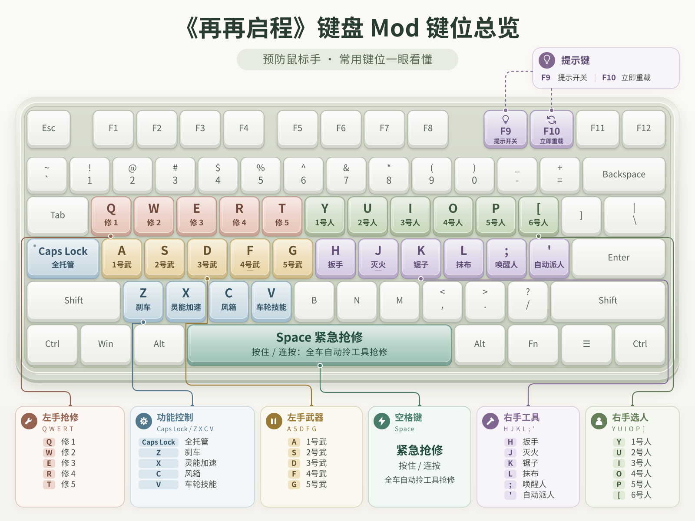
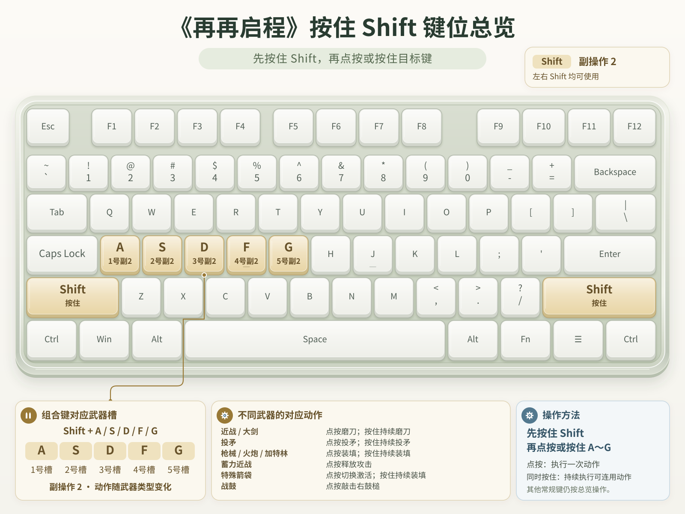

# 《再再启程》键盘 Mod

不用再点工具箱，解放鼠标，避免腱鞘炎。

## 安装 / 卸载

从 [Releases 下载最新版本](https://github.com/gantrol/one-way-tickets-keyboard-mod/releases/latest)（一键安装器或完整压缩包）。

1. 关闭游戏，运行 `双击一键安装或卸载Mod.exe`。
2. 确认自动识别的游戏目录，点击「一键安装 / 更新 Mod」；找不到目录时可手动浏览。
3. 卸载时再次运行安装器，点击卸载按钮。改键配置会保留。

**从 v1.0.0 升级**：先用 v1.0.0 安装器卸载旧版，再在 Steam 验证游戏文件完整性，恢复原版后安装新版。新版安装器不会还原旧版对 `World.dll` 的修改，也不会清理旧版文件或备份。

### 游戏更新后

**新版通过 BepInEx 独立加载，不修改 `World.dll`、游戏 EXE 或其他原版程序集。** 安装器添加 `winhttp.dll`、`doorstop_config.ini` 等加载器文件，并把 Mod 放在 `BepInEx/plugins/OneWayTickets.KeyboardMod/`。游戏启动时加载 Mod，键盘逻辑在内存中运行。

正常更新无需重新注入，Steam 也不会因本版本修改 `World.dll` 而校验失败。若游戏更新更改了 Mod 使用的接口，仍可能需要升级 Mod；重新安装整个游戏或删除加载器文件后则需重装 Mod。

安装器只管理新版自身的加载器和插件文件，保留用户配置和其他 Mod。未知加载器不会被覆盖，卸载会保留其他 Mod 使用的共享加载器。

内置加载器为官方 **BepInEx 5.4.23.6 / Windows x64**，组件与许可证见 [第三方声明](docs/BEPINEX_THIRD_PARTY_NOTICES.md)。

## 键位

Shift / Alt 组合键

`F9` 显隐提示；修改游戏目录下的 `OneWayTickets.KeyboardMod.ini` 后，按 `F10` 应用。

[详细机制与全武器动作表](docs/DESIGN.md)
